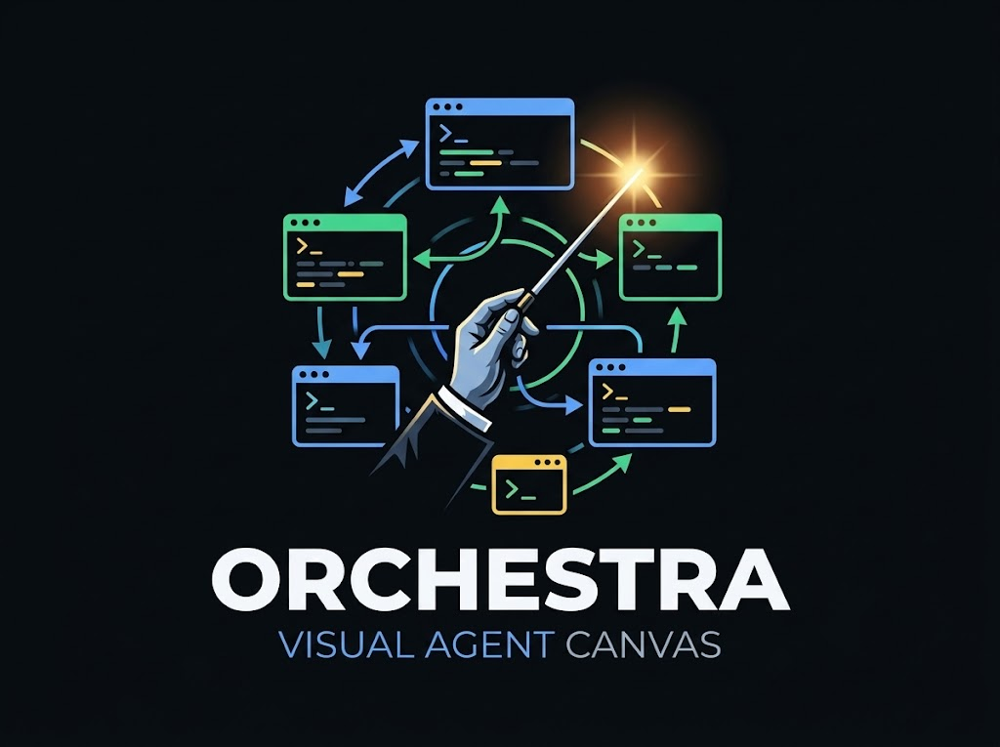
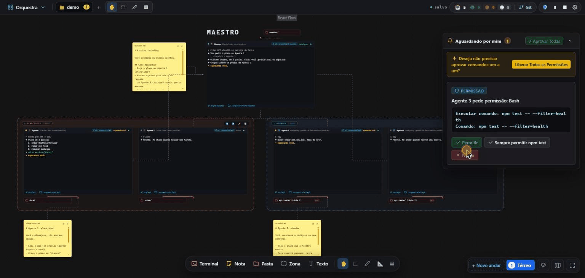

<p align="center">
  
</p>

<p align="center">
  Canvas visual para orquestrar agentes de código em <b>terminais reais</b>, com mensagens entre eles
  que passam pela <b>sua aprovação</b>.
</p>

<p align="center">
  <i>Projeto pessoal de <a href="https://github.com/ThallysCezar">Thallys Cézar</a> · Windows e Linux · em teste (pré-lançamento)</i>
</p>

<p align="center">
  
  <br />
  <sub>Interface em modo de demonstração (dados simulados): aprovar uma mensagem e uma permissão na fila "Aguardando por mim" e organizar o canvas.</sub>
</p>

---

## Download

<p align="center">
  <a href="https://github.com/ThallysCezar/Orquestrador-app/releases">
    
  </a>
</p>

| Plataforma | O que baixar na página da versão | Guia |
|---|---|---|
| **Windows** 10/11 (64 bits) | `Orquestra-Windows.zip` (instalador + certificado + passo a passo) | [`docs/instalacao-windows.md`](docs/instalacao-windows.md) |
| **Linux** (testado só em Ubuntu 24.04 no WSL2) | `Orquestra-Linux.zip` (AppImage + passo a passo) | [`docs/instalacao-linux.md`](docs/instalacao-linux.md) |

**[Baixar a última versão](https://github.com/ThallysCezar/Orquestrador-app/releases)**: a primeira da lista é a mais recente.
Todas as versões anteriores, com as notas de cada uma, ficam na mesma página: [**Releases**](https://github.com/ThallysCezar/Orquestrador-app/releases).
O que mudou em cada versão também está no [`CHANGELOG.md`](CHANGELOG.md).

> Depois de instalada uma versão com atualização automática, o próprio app avisa quando sair uma versão nova e atualiza
> com a sua confirmação (veja [Atualizações](#atualizações)).

---

## Como nasceu

Eu queria administrar melhor os meus agentes de código. Já usava mais de uma CLI ao mesmo tempo e, na prática, virava o
mensageiro entre terminais: copiando resposta de um, colando no outro. Procurei ferramentas, mas nenhuma era confiável
o bastante e atendia tudo o que eu precisava.

Então decidi criar a minha. A ideia foi juntar um pouco do que o **Maestri** faz com o jeito de trabalhar que a gente
conhece do **Excalidraw** e do **Miro** (um canvas livre, com blocos e setas), e acrescentar a parte de **orquestração**:
quem fala com quem, o que passa pela minha aprovação e o que fica registrado. Dessa mistura saiu o **Orquestra**. O nome
não é dos melhores, mas foi com ele que a ideia começou, e ficou.

Não fiz isso para vender nem para ser melhor do que nada: fiz por interesse meu e para atender às minhas necessidades,
de um jeito mais **seguro** do que eu tinha à mão.

O app foi feito junto com outras ferramentas, com agentes de IA: eu orquestrando e administrando as ideias e as decisões;
na parte do código, revisando, testando e entendendo o que os agentes escreviam. As decisões de projeto estão
registradas em [`docs/DECISOES.md`](docs/DECISOES.md).

## O que é

Cada agente (Claude Code, Antigravity, OpenCode) roda como um **terminal de verdade** dentro de um **canvas**, e você liga
os blocos com **setas** para dizer quem pode falar com quem. Um agente especial, o **Maestro**, recebe o seu pedido e
delega tarefas aos outros. Tudo o que um agente manda para outro vira uma **mensagem estruturada**, registrada em um banco
local e, por padrão, **segurada na fila "Aguardando por mim"** até você aprovar, editar ou rejeitar.

| Problema com vários terminais soltos | O que o Orquestra faz |
|---|---|
| Você não vê (nem controla) o que um agente manda para o outro | Cada mensagem vira um registro e pode esperar a sua aprovação |
| O texto de um agente vira "ordem" para o outro (injeção de prompt entre agentes) | O conteúdo chega por uma ferramenta MCP marcada como **dado**, nunca digitado como prompt |
| Agentes escrevendo no mesmo repositório se atropelam | Cada agente que escreve ganha seu próprio **git worktree** e uma branch só dele |
| Um agente em laço infinito | Limites de turnos e de repetição, e um botão de **pausar tudo** |

## Recursos

- **Canvas infinito com andares:** terminais, notas de briefing, pastas, zonas, textos e desenho livre; setas ortogonais,
  linhas-guia, camadas, modelos prontos e "Organizar" com um clique (Ctrl+Z desfaz).
- **Terminais reais:** o app roda a CLI do agente num pseudoterminal (ConPTY no Windows), então tudo que a CLI faz
  continua funcionando.
- **Três CLIs, no mesmo time:** Claude Code, Antigravity (`agy`) e OpenCode (inclusive com modelos locais via Ollama).
- **Fila "Aguardando por mim":** aprove, edite ou rejeite mensagens; pedidos de permissão do Claude Code e do OpenCode
  também aparecem ali. "Permissões Totais" existe, mas é opcional e exige confirmação.
- **Isolamento por worktree:** o repositório principal não é tocado. **O app nunca faz merge**: quem decide o que entra é você.
- **Histórico imutável:** mensagens e eventos ficam em SQLite com gatilhos que impedem apagar ou reescrever o passado;
  há uma aba de **reprodução** para rever o que aconteceu.
- **Vários workspaces:** abas e painel ao lado; os agentes do workspace anterior continuam rodando em segundo plano.
- **Controle de contexto:** cada tarefa começa numa conversa nova, com limite de tamanho de mensagem e um selo que mostra
  quanto texto o agente já recebeu.
- **Tema claro e escuro**, atalhos de teclado (`F1` lista todos).

## Como funciona (em uma figura)

```
 Interface (React, sem acesso ao sistema)
        │  IPC com canais nomeados e validados
 Processo principal (Node/Electron): broker de mensagens, servidor MCP, terminais, git, SQLite
        │  HTTP só em 127.0.0.1, com rota e token por agente
 CLIs dos agentes (claude / agy / opencode), cada uma no seu terminal e no seu worktree
```

Duas regras de projeto sustentam o resto: **os agentes nunca conversam diretamente** (tudo passa pelo broker) e **o
conteúdo das mensagens nunca é digitado no terminal** (só uma "cutucada" curta e fixa pede ao agente que leia a caixa
de entrada). Detalhes em [`docs/DECISOES.md`](docs/DECISOES.md).

## Requisitos e aviso do Windows

**Você precisa de:** Git e pelo menos uma CLI de agente já instalada e logada na sua conta. O Orquestra só orquestra;
quem trabalha é a CLI, com a **sua** conta e os **seus** limites de uso.

> **Sobre o aviso do Windows:** o instalador é assinado com um certificado **autoassinado** (não de uma empresa), então
> o Windows mostra "editor desconhecido" até você confiar nele (o guia explica, e só faça se confiar em mim). Um certificado
> comercial resolveria, mas é pago.

## Atualizações

A partir da versão que traz o recurso, o Orquestra **verifica sozinho** (ao abrir e a cada poucas horas) se existe uma versão
nova nas Releases deste repositório. Quando existe, aparece um aviso com as opções **Baixar e instalar**, **Ver novidades** e
**Depois**. Nada é instalado sem a sua confirmação, e o app confere a integridade (SHA-512) e a assinatura do instalador antes de
executá-lo. Dá para desligar a verificação em *Configurações do app*.

Instalações anteriores a esse recurso não se atualizam sozinhas: instale uma vez a versão nova manualmente.

## Segurança

- Servidor MCP **só em `127.0.0.1`**, uma porta, com token aleatório por agente (revogado quando o processo termina);
  pedidos de navegador (`Origin`) são recusados.
- Interface sem `nodeIntegration`, com `contextIsolation` ligado e canais IPC validados.
- Ambiente mínimo para cada agente (sem variáveis de credenciais herdadas).
- **Use só repositórios de teste.** O projeto ainda está em teste e agentes de código executam comandos de verdade.

## Limitações conhecidas

- Em teste: usado e verificado principalmente no **Windows**. No Linux, só dentro do WSL2; instalação em máquina limpa
  ainda não foi verificada.
- **Docker por agente** (isolamento mais forte que o worktree) foi adiado.
- O `agy` não expõe pedidos de permissão para a fila: as permissões dele ficam no próprio terminal.
- Modelos locais pequenos (3B) abrem e recebem a mensagem, mas não usam bem as ferramentas MCP.
- Certificado autoassinado (veja acima). Sem atualização automática: atualizar é rodar o instalador novo por cima.
- Sem licença definida por enquanto: o código-fonte **ainda não é aberto**.

## Status

Pré-lançamento. O histórico de versões está no [`CHANGELOG.md`](CHANGELOG.md).
Próximos passos prováveis: instalação em máquina limpa, Docker por agente e a decisão de abrir o código (com licença).
